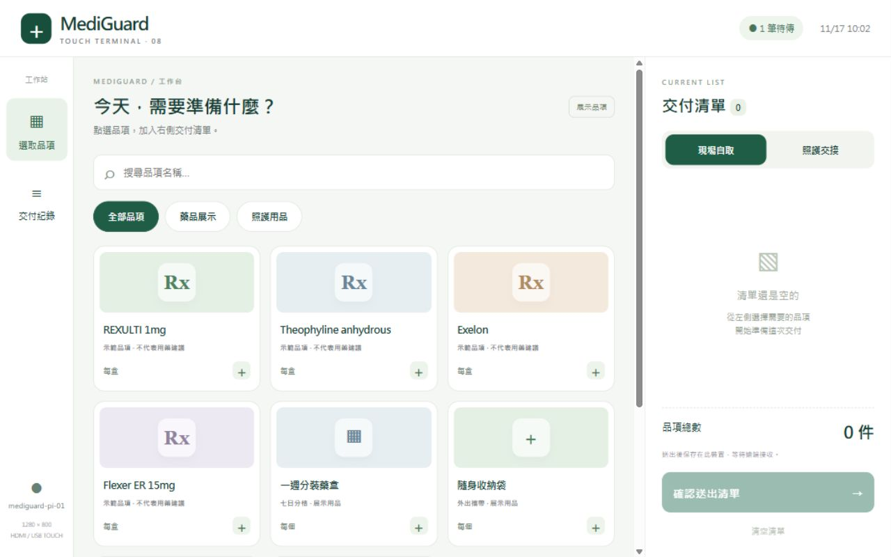

# MediGuard 樹莓派 · 8 吋 HDMI 觸控工作站

**Raspberry Pi 3B／1 GB 使用者：**請使用 [Raspberry Pi OS Lite 32 位元＋Openbox 部署指南](docs/pi3-lite-openbox.md)。下方 Ubuntu／GNOME 流程適用記憶體較充足的機型。安裝器支援 `KIOSK_DESKTOP=openbox`，套件預先安裝完成時加 `SKIP_PACKAGE_INSTALL=1`，只建立服務與自啟設定。Pi OS 使用原生 Chromium，不安裝 GNOME 或 Snap。

針對 **Waveshare 8DP-CAPLCD、1280 × 800、橫向、100% 顯示縮放**設計的獨立 POS 風格介面。在 **Ubuntu Server 24.04 LTS（arm64）加裝 GNOME 桌面**後，由 Python 提供本機網站，再以 Chromium kiosk 全螢幕顯示。手機熱點提供網際網路，Tailscale 提供裝置之間的私有連線。

這是 MediGuard 的品項選取／交付工作站：不是餐廳點餐資料，也不提供收款、庫存扣帳、處方審核或藥物辨識。藥品為展示目錄，選取不代表可自行購買或服用。原有網站與 `../raspberry_pi` 相機服務維持獨立；本版本不需要先啟動 Node、Docker、相機或 MedicServer。

Ubuntu Server 預設只有文字介面；要在 HDMI 螢幕直接操作本介面，需先安裝圖形環境。此指南採用 GNOME／GDM，不必重新刷成 Desktop 映像。只有遠端接收資料、不接螢幕的主機可維持純 Server。

**部署順序：先依第 3 節確認熱點上網 → 第 2 節安裝桌面與設定螢幕 → 第 4 節安裝 POS 與自啟 → 第 5–6 節設定 Tailscale。** 原 Raspberry Pi OS 的 `raspi-config`、labwc 流程不適用 Ubuntu GNOME。

需要逐項點選／貼指令的說明，請看 [第 4、5 步操作指南](docs/ubuntu-steps-4-5.md)，包含螢幕、自動登入、不休眠，以及手機瀏覽與 Windows 接收端的完整同步測試。

若從舊 OS 搬移：先停止舊機服務，再備份並複製 `.env` 與完整 `data/`（自訂 `POS_DB` 則複製該位置）；在 Ubuntu 確認由新的登入使用者擁有，更新 `.env` 中舊的絕對路徑。草稿屬於舊瀏覽器的 localStorage，不會隨 SQLite 搬移，請先完成保存。重新安裝 OS 後須重新登入 Tailscale，檢查裝置名稱與 Serve URL，不能假設會與舊機相同。

## 1. 功能與檔案



- 三欄觸控介面：主選單、分類／搜尋／品項卡、交付清單。
- 自取／照護交接、數量 1–99、刪除與清空確認、保存確認。
- 草稿存瀏覽器 localStorage，正式紀錄存 SQLite，重新啟動仍保留。
- 斷網仍可選取與保存；每 30 秒重試傳送，每輪最多 20 筆，亦可手動同步。
- 每筆 UUID 與內容固定；接收端重送不重複建立，內容衝突會拒絕。
- 最近 100 筆紀錄、傳送狀態及 JSON 匯出。匯出不是完整資料庫備份。
- 無 CDN、網路字型或第三方 Python 套件，啟動後本機畫面不依賴外網。

```text
raspberry-pi-8inch/
├── README.md
├── server.py              Python HTTP API、SQLite、背景同步、接收端
├── catalog.json           可自行修改的品項展示目錄
├── .env.example           環境範本；複製成 .env
├── static/                HTML、CSS、JavaScript
├── scripts/install.sh     安裝本機服務與桌面自啟
├── scripts/kiosk.sh       全螢幕 Chromium 啟動器
├── tests/test_server.py    持久化、重試、權限與 HTTP 測試
└── data/pos.sqlite3        第一次啟動自動建立，不納入 Git
```

## 2. Ubuntu Server 24.04、桌面與螢幕

建議 Raspberry Pi 4／5、**4 GB 以上 RAM**（本指南使用 GNOME）、32 GB 以上 microSD、合適的樹莓派電源，以及初次設定用鍵盤、滑鼠。Pi 4／5 需 micro-HDMI → HDMI 線。

1. 樹莓派 HDMI → 螢幕 HDMI：傳送畫面。
2. 螢幕 **Touch** → 樹莓派 USB：傳送觸控，USB 線須支援資料；HDMI 不提供觸控。
3. 螢幕 **Power Type-C** → 穩定 5V 電源。官方額定約 800mA、4W，可用獨立 5V／1A 或以上合規電源。依實體標示分辨 Touch／Power。
4. 已安裝 Ubuntu Server 就不需重刷。用 `cat /etc/os-release`、`uname -m` 確認 **24.04、aarch64**，使用自己的非 root 帳號。本程式需 Python 3.11+，Ubuntu 24.04 的 Python 3.12 可用。
5. 先依第 3 節接上手機熱點，也可先用有線網路下載套件。Server 尚未裝桌面時，HDMI 顯示文字登入畫面是正常的。

產品接線參考：[Waveshare 8DP-CAPLCD](https://www.waveshare.net/wiki/8DP-CAPLCD)。

### 加裝 GNOME 圖形桌面

確認可連外後執行；下載桌面套件會消耗手機流量與 SD 卡空間：

```bash
sudo apt update
sudo apt upgrade -y
sudo apt install -y ubuntu-desktop-minimal gdm3
# 若詢問預設 display manager，選 gdm3。
sudo systemctl set-default graphical.target
sudo systemctl enable gdm3
sudo timedatectl set-timezone Asia/Taipei
sudo reboot
```

重開後應出現 Ubuntu 圖形登入畫面；用之後執行安裝腳本的帳號登入。若套件找不到，檢查 Ubuntu 官方 apt 軟體來源及連線。參考：[Ubuntu 24.04 桌面套件](https://packages.ubuntu.com/noble/ubuntu-desktop-minimal)、[官方樹莓派 Server 安裝指南](https://ubuntu.com/tutorials/how-to-install-ubuntu-on-your-raspberry-pi)。

### HDMI 解析度與 USB 觸控

在 **Settings → Displays（設定 → 顯示器）**選 HDMI 螢幕，設 **1280×800、60Hz、Landscape／橫向、Scale 100%**，套用並保留。Chromium 按 Ctrl+0 還原 100% 瀏覽器縮放，重新登入確認。

USB 觸控應由 HID 自動辨識，初次先只接這一台螢幕。需要搜尋輸入時，可到 **Settings → Accessibility → Typing → Screen Keyboard** 啟用螢幕鍵盤。

### 透過 SSH 改成直式（GNOME 已登入）

將最新的 `scripts/rotate-display.py` 同步到樹莓派後，以**本機桌面已登入的同一帳號** SSH 進入。工具使用 GNOME／Mutter 的 session D-Bus，適用本指南的 GNOME 桌面，不依賴 `xrandr`，也不需要在 SSH 手動設定 `DISPLAY=:0`。

```bash
sudo apt install -y python3-gi
cd ~/MediGuard_AI/MedicWebSite/raspberry-pi-8inch
# 只讀取狀態，確認可連到桌面：
/usr/bin/python3 scripts/rotate-display.py
# 旋轉 90 度；此行不要 sudo：
/usr/bin/python3 scripts/rotate-display.py --rotation 90
# 方向相反時改成 270：
# /usr/bin/python3 scripts/rotate-display.py --rotation 270
# 還原橫向：
# /usr/bin/python3 scripts/rotate-display.py --rotation 0
```

保留目前硬體解析度與縮放；1280×800／100% 旋轉 90 或 270 度後，可用畫面為 800×1280。設定立即影響目前桌面／kiosk，無須重跑安裝腳本。工具限定一個啟用螢幕，先驗證再套用並讀回方向；預設要求保存至使用者的顯示設定，重開後仍應實機確認。加 `--temporary` 可只暫時套用。

找不到 session bus 或 GNOME 服務時，先完成桌面登入／自動登入，純 Server 文字模式無法用此工具旋轉桌面。工具不更改開機文字畫面或 GDM 登入畫面的方向。完成後檢查 USB 觸控位置；若觸控方向不一致，需另查輸入裝置對應。POS 排版目前仍以橫向三欄為主，旋轉不會替代直式版面設計。

介面合約參考：[GNOME 46 Mutter DisplayConfig](https://github.com/GNOME/mutter/blob/gnome-46/data/dbus-interfaces/org.gnome.Mutter.DisplayConfig.xml)。此工具已做 Python 語法檢查，仍需在 Ubuntu GNOME 實機驗證旋轉、保存與觸控。

若 EDID 辨識錯誤，先檢查電源、HDMI 線與螢幕 OSD。必要時才使用 KMS 備援：

```bash
ls /sys/class/drm/
cat /sys/class/drm/card*-HDMI-A-*/modes
sudo cp /boot/firmware/cmdline.txt /boot/firmware/cmdline.txt.before-mediguard
sudo nano /boot/firmware/cmdline.txt
```

在**原有同一行末端**加上 ` video=HDMI-A-1:1280x800@60D`，不可另開新行或刪除原有參數。若接第二個輸出，改為實際接頭 `HDMI-A-2`。儲存後重新開機；異常時移除此參數或還原備份。如果該檔不存在，先確認映像實際開機設定位置，不要建立空檔替代。

Waveshare 文件中的 `hdmi_group / hdmi_mode / hdmi_cvt` 為舊式設定，不要直接套到 Ubuntu 現行 KMS。本專案不自動修改開機分割區。

## 3. 手機熱點上網（Server 先完成此節）

手機開啟行動數據與熱點；初次建議用 2.4GHz／最大相容性模式。Ubuntu Server 通常由 **Netplan／systemd-networkd** 管理網路，不保證已安裝 `nmcli`。

先從本機 HDMI 文字終端機查看網卡與既有設定：

```bash
ip -br link
ls /etc/netplan/
sudo cp -a /etc/netplan /etc/netplan.before-mediguard
# 以實際存在的檔名為準，例如：
sudo nano /etc/netplan/50-cloud-init.yaml
```

編輯現有設定的 Wi-Fi 區塊，保留既有 ethernet 設定。不要在多份 YAML 重複定義同一網卡。以下是 networkd 範例，`wlan0` 須替換為實際名稱，縮排使用空白：

```yaml
network:
  version: 2
  renderer: networkd
  wifis:
    wlan0:
      dhcp4: true
      optional: true
      access-points:
        "你的手機熱點名稱":
          password: "你的手機熱點密碼"
```

密碼只存於受保護的系統設定，不要提交 Git。替換下列檔名為剛編輯的檔案：

```bash
sudo chmod 600 /etc/netplan/50-cloud-init.yaml
sudo netplan generate
sudo netplan try --timeout 120
# 確認連線正常後依提示按 Enter 接受；未確認時會嘗試還原。
ip -br address
ip route
curl -I https://tailscale.com
```

建議從本機操作，避免 SSH 因修改網路斷線；`netplan try` 失敗後仍須檢查設定與連線是否已還原。若既有 renderer 是 NetworkManager，不要直接換成 networkd，沿用既有管理方式。

若檔案由 cloud-init 產生且檔頭指出可能重建，先確認重開機是否保留設定。要改成手動 Netplan 管理時，先備份並確認已有完整可用設定，再在 `/etc/cloud/cloud.cfg.d/99-disable-network-config.cfg` 寫入 `network: {config: disabled}`，停用 cloud-init 的網路產生功能；保留現有 Netplan 檔案。此選項只在確定不再由 cloud-init 管理網路時使用。

安裝桌面後若 `nmcli device status` 顯示 Wi-Fi 由 NetworkManager 管理，才改用右上 Wi-Fi 選單或：

```bash
nmcli --ask device wifi connect '你的手機熱點名稱'
nmcli connection show
# 使用實際連線名稱：
nmcli connection modify '你的熱點連線名稱' connection.autoconnect yes
```

若顯示 unmanaged，沿用 Netplan／networkd 即可，不必為了選單改 renderer。不要同時由兩套服務控制同一張 Wi-Fi 卡。

熱點只負責上網；Tailscale 不需要固定熱點 IP、路由器轉發埠或公網 IP，接收電腦可以在另一個網路。手機可能自動關閉閒置熱點，請檢查省電設定。斷網後本機仍能保存，遠端傳送等恢復連線再繼續。

官方參考：[Ubuntu Server 網路設定](https://ubuntu.com/server/docs/configuring-networks/)、[Netplan 範例](https://netplan.readthedocs.io/en/stable/examples/)。

## 4. 先啟動本機版

把此專案複製到樹莓派，例如 `~/MediGuard_AI`。**安裝路徑請不要含空白、%、引號或反斜線**。

```bash
cd ~/MediGuard_AI/MedicWebSite/raspberry-pi-8inch
sudo apt update
sudo apt install -y python3 snapd fonts-noto-cjk curl
sudo systemctl enable --now snapd.socket
sudo snap wait system seed.loaded
# 已安裝可略過；用 snap list chromium 檢查。
sudo snap install chromium
cp .env.example .env
chmod 600 .env
python3 server.py
```

在樹莓派的 Chromium 開啟 **http://127.0.0.1:8088**。選品項 → 調數量 → 確認送出清單 → 確認保存 → 交付紀錄。未設定同步時，顯示本機模式與待傳筆數是正常的；設定完成後，舊資料也會排隊傳送。先 Ctrl+C 停止手動服務，再進行自動安裝，避免占用 8088 埠。

Ubuntu 的 Chromium 使用 Snap，原本 Raspberry Pi OS 的 `apt install chromium` 不能直接沿用。啟動器會使用 `/snap/bin/chromium` 與專用資料目錄 `~/snap/chromium/common/mediguard-chromium`，避開 Snap 對隱藏家目錄的存取限制。不要 sudo 啟動 Chromium，也不要加入 `--no-sandbox`。[Ubuntu chromium-browser 套件說明](https://packages.ubuntu.com/noble/chromium-browser)。

專用資料目錄依 [Snap 官方使用者資料位置](https://snapcraft.io/docs/reference/administration/data-locations/)配置；原本 Raspberry Pi OS 的瀏覽器設定／草稿不會自動搬到新 profile。

### 自動安裝與開機全螢幕

使用**桌面登入使用者**執行，不要 `sudo bash`：

```bash
cd ~/MediGuard_AI/MedicWebSite/raspberry-pi-8inch
bash scripts/install.sh
bash scripts/kiosk.sh
```

腳本會辨識 Ubuntu，透過 Snap 安裝 Chromium，保留既有 `.env`，建立 `mediguard-pos.service` 與目前使用者的 `~/.config/autostart/mediguard-pos.desktop`。Chromium 在 GNOME GUI session 就緒後才啟動。**腳本不會安裝整套桌面、切換網路或啟用自動登入**；請先完成第 2 節。

在 Ubuntu **Settings → System → Users**（部分介面直接顯示 Users）解鎖設定，選執行腳本的帳號，開啟 **Automatic Login**。這會讓能接觸設備的人直接進入該帳號，適合專用工作站；不開啟也可每次手動登入後自動啟動 kiosk。Ubuntu 不使用 `raspi-config`。

介面操作參考：[Ubuntu 自動登入說明](https://help.ubuntu.com/stable/ubuntu-help/user-autologin.html.en)。

在本機桌面終端機，以同一使用者、**不加 sudo**執行，停用閒置黑屏、自動鎖定及休眠：

```bash
gsettings set org.gnome.desktop.session idle-delay 'uint32 0'
gsettings set org.gnome.desktop.screensaver lock-enabled false
gsettings set org.gnome.settings-daemon.plugins.power sleep-inactive-ac-type 'nothing'
gsettings set org.gnome.settings-daemon.plugins.power sleep-inactive-battery-type 'nothing'
sudo reboot
```

重開後應先進桌面，再進全螢幕介面。只有文字登入時查 `systemctl get-default` 與 `systemctl status gdm3`；停在圖形登入畫面則確認自動登入帳號。已進桌面卻沒開 Chromium 時，查看自啟檔並從本機桌面執行 `bash scripts/kiosk.sh`。**Ubuntu GNOME 不使用 `~/.config/labwc/autostart`。**

啟動器有單一實例鎖；Alt+F4 預設退出後不重啟，便於維護。希望退出後自動重啟時，把 `.desktop` 的 Exec 命令改為 `env KIOSK_RESTART=1 /完整路徑/scripts/kiosk.sh`。kiosk 是全螢幕操作模式，不是阻止使用者離開桌面的安全鎖。

## 5. Tailscale 私有連線

在**樹莓派與遠端接收電腦**都安裝 Tailscale，登入相同 tailnet（或使用明確分享及授權）。Linux 官方安裝方式：

```bash
curl -fsSL https://tailscale.com/install.sh -o /tmp/tailscale-install.sh
# 可先檢閱腳本，再執行：
sh /tmp/tailscale-install.sh
sudo tailscale up
tailscale status
tailscale ip -4
```

依終端機網址登入。接收電腦依其 OS 使用[官方安裝指南](https://tailscale.com/docs/install)；Linux 可沿用上列方式。裝置需通過 tailnet 裝置核准／到期政策。使用 `tailscale ping 接收端名稱` 驗證；顯示 relay 表示經中繼，仍可傳輸，速度依行動網路而異。

預設服務只監聽 `127.0.0.1`。使用 **Tailscale Serve** 將其公開給 tailnet 內獲准裝置，請勿使用 Funnel（那是公開網際網路用途）：

```bash
sudo tailscale serve --bg http://127.0.0.1:8088
tailscale serve status
```

第一次會要求依連結啟用 tailnet HTTPS／DNS 功能；以命令回傳的 **實際 `https://....ts.net` URL** 為準。帳號的 grants／ACL 應只允許操作人員與指定裝置存取 TCP 443。Serve 設定會持續存在；可用 `sudo tailscale serve reset` 移除，該命令會移除該裝置所有 Serve 設定，若已有其他服務請先檢查。

在手機也安裝 Tailscale 並加入同一 tailnet，即可用瀏覽器開啟樹莓派 Serve URL 查看／操作同一份資料。若手機作為熱點時無法同時使用 VPN，改用另一台加入 tailnet 的裝置測試；樹莓派連到遠端接收端不依賴熱點手機安裝 Tailscale。

本版本 UI 沒有帳密系統：取得此私有網址存取權的裝置可以看紀錄與操作清單。不要改成 `0.0.0.0` 暴露至熱點或其他網路，除非另行配置防火牆與驗證。同步 Token 只保存在伺服器 `.env`，不傳給瀏覽器。

官方：[Linux 安裝](https://tailscale.com/docs/install/linux)、[Serve 指令](https://tailscale.com/docs/reference/tailscale-cli/serve)。

## 6. 實際傳資料：接收端 → 樹莓派設定

這個套件**包含可運作的接收 API**，不是只設定 VPN。資料流：

```text
8 吋 HDMI + USB 觸控
  → 樹莓派 Chromium → 127.0.0.1:8088 → 本機 SQLite 待傳佇列
  → 手機熱點上網 → Tailscale 加密網路
  → 接收電腦 HTTPS Serve → /api/receive → 接收電腦 SQLite
```

### A. 設置遠端接收電腦

複製整個 `raspberry-pi-8inch` 資料夾到接收端，需 Python 3.11+。在該資料夾產生 Token：

```bash
python3 -c "import secrets; print(secrets.token_urlsafe(32))"
cp .env.example .env
chmod 600 .env
nano .env
```

接收端 `.env`：

```dotenv
POS_HOST=127.0.0.1
POS_PORT=8088
POS_DEVICE_ID=mediguard-receiver
POS_SYNC_URL=
POS_SYNC_TOKEN=貼上剛產生的長隨機字串
```

**值不要加引號**，不要將 Token 上傳 Git。接收端 `POS_SYNC_URL` 留白，避免把自己的資料再傳出去。

```bash
python3 server.py
# 另一個終端機執行：
sudo tailscale serve --bg http://127.0.0.1:8088
tailscale serve status
```

接收端若也是 Ubuntu／Raspberry Pi OS 桌面，可用 `bash scripts/install.sh` 建立相同服務；不需要螢幕時移除該使用者的 `~/.config/autostart/mediguard-pos.desktop`。其他 Linux／Windows 主機應自行把 Python 程序設為持續執行服務。Windows 可用 `py -3 server.py`，複製檔案改用 `Copy-Item .env.example .env`，透過系統管理員終端機執行 `tailscale serve --bg http://127.0.0.1:8088`。首次測試時保持接收端終端機開啟。

### B. 設置樹莓派傳送端

編輯樹莓派 `.env`：

```dotenv
POS_HOST=127.0.0.1
POS_PORT=8088
POS_DEVICE_ID=mediguard-pi-01
POS_SYNC_URL=https://接收端實際名稱.你的tailnet.ts.net/api/receive
POS_SYNC_TOKEN=與接收端完全相同的Token
```

網址指向**接收電腦**，不是樹莓派自己、不是手機熱點 IP，也不是原有 MedicServer 的 `/api/v1/verifications`。使用 Serve 顯示的真實網址替換上例。

```bash
sudo systemctl restart mediguard-pos
```

在 8 吋螢幕保存一份清單，進交付紀錄按「立即同步」，等待狀態更新（畫面每 10 秒更新）。接收電腦開 `http://127.0.0.1:8088` → 交付紀錄，應看到「遠端接收」。送出端顯示「已同步」表示遠端已以相同 ID 確認保存。零待傳並不代表已探測遠端連線，狀態文字會明確說明。

**斷線驗收**：關閉熱點 → 新增清單並保存 → 重啟本機服務仍有待傳紀錄 → 開啟熱點 → 確認 Tailscale 恢復 → 約 30 秒後／手動同步 → 接收端只新增一次。遠端程序關閉、Token 不一致或 HTTPS 錯誤時，資料保留在待傳佇列。

### 與原專案整合的界線

這是獨立的交付紀錄 API；沒有自動寫入 MedicServer PostgreSQL，也沒有呼叫相機辨識。若要讓原後端接收，需新增相容的接收路由或轉接器，再把 `POS_SYNC_URL` 指向該路由。不要將交付 JSON 當作藥物影像檔上傳。

## 7. 設定與 API 合約

`.env` 每行為 `NAME=value`，不支援 shell 變數展開；作業系統環境變數優先，修改後重啟服務。

| 變數 | 預設／用途 |
| --- | --- |
| `POS_HOST` | `127.0.0.1`，交給 Tailscale Serve 做私有遠端入口 |
| `POS_PORT` | `8088`；kiosk 會讀取 `.env` 的此值，修改後重啟 kiosk、網站服務並更新 Serve 目標 |
| `POS_DEVICE_ID` | `mediguard-pi-01`；多台裝置請使用不同名稱 |
| `POS_DB` | 預設此資料夾的 `data/pos.sqlite3`，可填絕對路徑 |
| `POS_SYNC_URL` | 完整接收端 `/api/receive` URL；留白只保存本機 |
| `POS_SYNC_TOKEN` | 傳送與接收共用 Bearer Token；留白禁止接收 |

| API | 說明 |
| --- | --- |
| `GET /api/status` | 裝置、待傳筆數、同步設定與最近結果；不回傳 Token |
| `GET /api/catalog` | 讀取展示目錄 |
| `GET /api/records` | 最近 100 筆（包含接收紀錄） |
| `POST /api/records` | 建立本機紀錄，品項須存在目錄，名稱以伺服器為準 |
| `POST /api/sync` | JSON `{}`，非同步觸發一次同步 |
| `POST /api/receive` | 接收完整紀錄，必須帶 `Authorization: Bearer <Token>` |

POST 皆要求 `Content-Type: application/json`，上限 64 KiB。紀錄格式：

```json
{
  "id": "6ce92c83-cc62-4dd8-a231-aa58a8e6c274",
  "device": "mediguard-pi-01",
  "created_at": "2026-11-17T00:00:00.000Z",
  "mode": "自取",
  "items": [{"id": "demo-01", "name": "REXULTI 1mg", "quantity": 2}]
}
```

成功回覆 `{"ok":true,"id":"原紀錄UUID"}`；同步只在 ID 與成功旗標一致後標記已傳。`mode` 限 `自取`／`交接`。received 紀錄不再轉送，避免回圈。失敗依原順序下輪重試，因此第一筆持續錯誤會阻擋後續批次，應先檢查接收端合約或 Token。

要改品項：編輯 `catalog.json`（id 必須唯一、穩定），保留 `id/name/category/unit/symbol/color/description` 欄位。`color` 支援 mint、blue、peach、lilac；分類按鈕在 `static/index.html`，若新增分類需一併修改。重啟服務並重新整理畫面。請先完成尚未確認的送出，再更動目錄，避免草稿與名稱變更衝突。

## 8. 維護、更新與排錯

```bash
sudo systemctl status mediguard-pos --no-pager
journalctl -u mediguard-pos -n 80 --no-pager
curl http://127.0.0.1:8088/api/status
sudo systemctl restart mediguard-pos
tailscale status
tailscale ping 接收端名稱
tailscale serve status
```

- **有畫面不能觸控**：確認 Touch USB、資料線、重新插接；只有 HDMI 不會有觸控。
- **畫面太大或被裁切**：桌面設 1280×800／100%，瀏覽器 Ctrl+0；用 OSD 檢查 overscan／比例。
- **全黑、閃爍**：檢查獨立 5V 供電、HDMI 線與 `cmdline.txt` 備份；先退出 kiosk 確認 OS 桌面正常。
- **沒自動全螢幕**：確認桌面自動登入的是安裝者、`systemctl status` 正常，從桌面執行 `bash scripts/kiosk.sh`；確認 GDM／GNOME 已登入，檢查 XDG 自啟檔。不要從純 SSH session 啟動 GUI。
- **Chromium 顯示資料目錄無法寫入**：更新 `scripts/kiosk.sh`，確認 Snap 使用 `~/snap/chromium/common/mediguard-chromium`，且檔案由桌面使用者擁有；不要用 sudo 執行瀏覽器。
- **待傳一直增加**：先查熱點上網，再查兩端 Tailscale、Serve URL、接收服務與相同 Token。這不是要開手機路由器埠。
- **畫面本機服務離線**：先確認 Python 服務；不要清瀏覽器草稿，資料庫／磁碟錯誤修復後再按保存重試。
- **手機無法看即時變化**：同一份紀錄每 10 秒更新；清單草稿各瀏覽器獨立，未實作多人共同編輯。
- **匯出找不到檔案**：在 Chromium 預設 Downloads 目錄。USB 備份可先 Alt+F4 回桌面複製檔案。

完整備份：停止服務，複製整個 `data/` 及受保護的 `.env` 到安全儲存位置，再啟動服務；若設定 `POS_DB`，備份其所在位置（包含可能存在的 `-wal/-shm` 檔）。資料庫未做磁碟加密，裝置遺失可能導致資料外洩，實際部署請依需求使用 OS 儲存保護。不要在展示目錄放真實個資。

更新程式時先備份，保留 `.env`／`data/`，替換原始碼，再重啟服務、重新整理 Chromium。本版本不自動刪除紀錄，請自行規劃磁碟容量與留存政策。

移除自啟與服務（保留原始碼與資料）：

```bash
sudo systemctl disable --now mediguard-pos
sudo rm /etc/systemd/system/mediguard-pos.service
sudo systemctl daemon-reload
rm ~/.config/autostart/mediguard-pos.desktop
# 若從舊版 Raspberry Pi OS 搬過來且曾加 labwc 自啟，另移除自己加的那一行。
```

## 9. 開發驗證與硬體驗收

```bash
python3 -m unittest discover -s tests -v
# 若開發機有 Node，可另查 JS 語法（樹莓派執行不需要 Node）：
node --check static/app.js
```

自動測試涵蓋 HTTP 路由、未授權接收、跨站寫入拒絕、數量驗證、重送不重複、ID 衝突、斷線保留與確認後標記同步。測試使用暫存資料庫，不修改正式資料。

部署後仍需實機驗收：1280×800 不裁切、USB 觸控準確、重新開機自啟、熱點重新連線、斷網新增與重啟保留、Tailscale 復線後只接收一次，以及滿清單可捲動。軟體測試無法替代實體電源、螢幕、觸控及電信網路測試。
